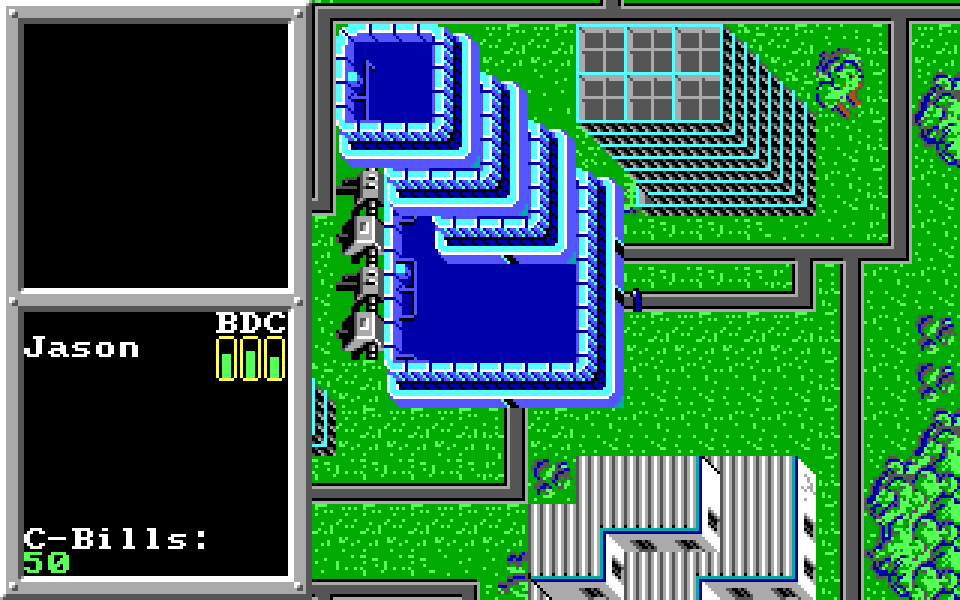
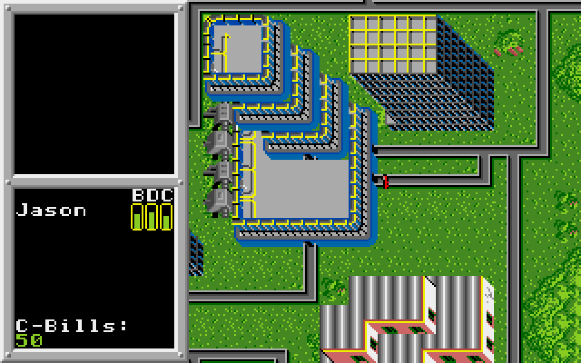
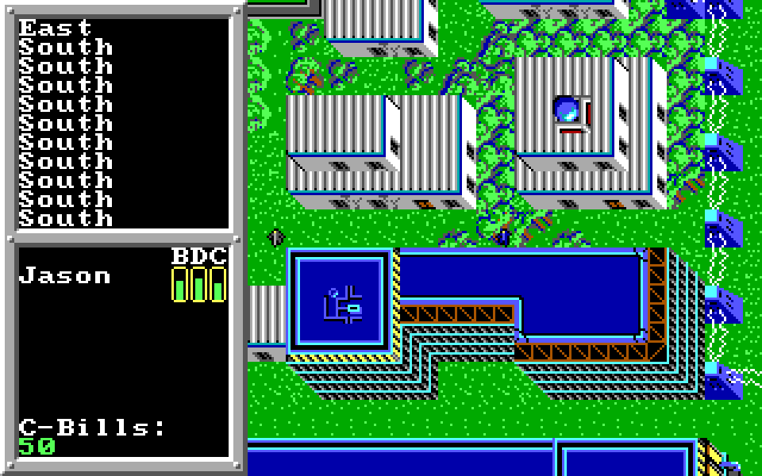
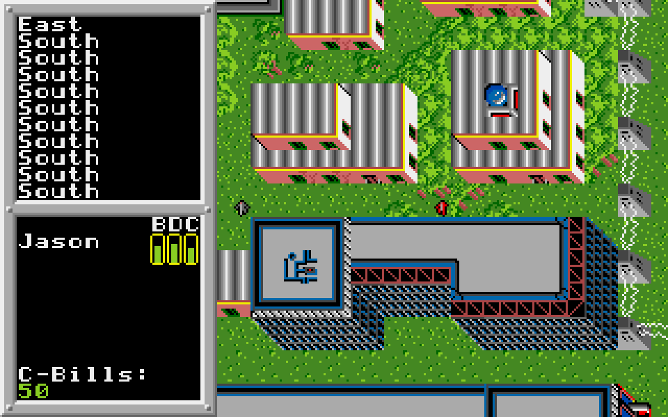
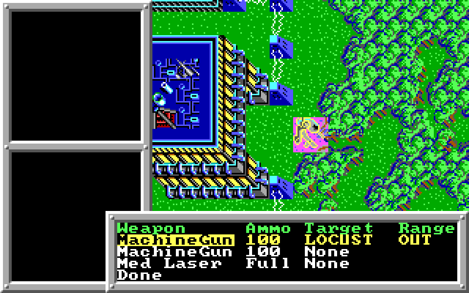
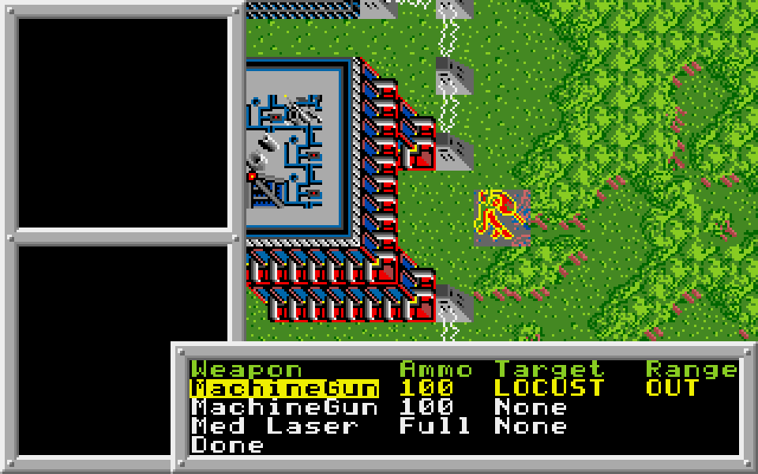
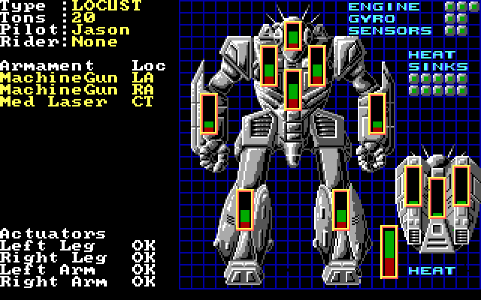
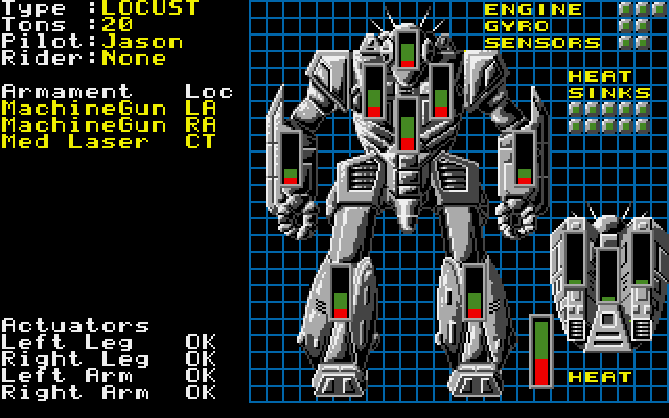

# Inception RE

A ground-up rebuild of **BattleTech: The Crescent Hawk's Inception** (Infocom,
1988, written by Westwood Associates) in modern C++, so the game runs on
today's Windows, macOS and Linux.

| DOS | Amiga |
|---|---|
|  |  |
|  |  |
|  |  |
|  |  |

*The rebuild running with the player's own DOS or Amiga copy. The art shown is the
original game's and belongs to its rights holders; none of its files are in this project.*

This is **not** an emulator, a static recompilation or a patched copy of the
original. Every line is new. We study the original DOS program to learn
exactly what it does, then write our own code that does the same thing. The
aim is for the rebuild to play as the original did, and for its source and
notes to document how the original worked, for preservation and research.

**Status:** chi-v1.0.1 is out for Windows, macOS and Linux on the
[Releases page](https://github.com/telltaleatheist/inception-re/releases). Please
update if you have 0.1.0 or 1.0.0: both can change a game you loaded and later saved
to the same slot. It is checked against the original DOS game; what is known to
differ, and what no one has played yet, is in its notes. You need your own copy of the DOS version 1.03
or the Amiga version 2.3 (below); the first start finds it or asks you where it is.

## You need your own copy of the game

The rebuild contains none of the original's files. It reads the graphics,
maps, animations and text from your own copy, so you need a copy of the game to
play it: the DOS version 1.03, which is the reference, or the Amiga version 2.3.
Commodore 64 and Apple II copies are named but not played
([docs/versions.md](docs/versions.md)).

## The rules

This project is unofficial and non-commercial. It distributes none of the
original's files and none of its code. It is not affiliated with or endorsed
by the holders of any rights in Infocom, Westwood or BattleTech. The full
rules are in [docs/rules.md](docs/rules.md).

## Building

You need CMake 3.20 or later, a C++20 compiler and SDL3 (macOS: `brew install
sdl3`).

    cmake -S . -B build -DCHR_GAME_DIR=/path/to/your/game
    cmake --build build
    ctest --test-dir build
    build/chr

`chr` looks for the game in `--game-dir DIR`, then in the `CHR_GAME_DIR`
environment variable, then where the setup put it (the folder remembered in
its data folder's `settings.ini`, the folder given when it was built, the data
folder's `install`). Without any of those, it opens the setup, which finds
your copy (or lets you pick it, its folder, its disk image or an archive it came in) and
copies it into the data folder; `chr --setup` opens it on purpose and
`chr --status` prints what is found (docs/setup.md). It
starts at the title screen, or with `--map N` on map N with the side panel (map 1 is
the town a new game starts in). Walk with the arrow keys, and Home, PgUp, End
and PgDn for the diagonals. Shift+Alt+F1 (Cmd+Shift+F1 on a Mac) opens the setup
kit's menu over the game, which waits meanwhile: the game files in use (CHANGE
sets them up again and restarts the game, `chr --setup --then-play`), updates,
a check of the files and where to report a problem; Esc goes back. On Windows,
if the keyboard-layout hotkey Alt+Shift is turned on, those keys may also switch
the layout. `--script "up*5 y"` plays keys first and prints
what each did; with `--screenshot FILE.bmp` it writes one frame and quits
without opening a window.

The font and some of the game's text live inside your own copy's program:
`BTECH.EXE`, which must be DOS version 1.03, or the Amiga 2.3's, which has no
font, so the rebuild shows its own. The first time `chr` runs it imports them into its
data folder (`--data-dir DIR`, else `CHR_DATA_DIR`, else your
application-data folder); `chr --import` does it again. `--text FILE` lays a
translation or rewrite over the game's text (docs/import.md).

The training center's first visit had a quiz on 'Mech parts, the original's
copy protection. The rebuild has no such check: it skips the quiz. With
`--show-quiz` it shows the quiz as the original laid it out, with the right
part already picked and any answer accepted (docs/combat.md 7).

## Credits and licence

- **BattleTech: The Crescent Hawk's Inception** was written by Westwood
  Associates and published by Infocom in 1988. All the game's content is
  theirs and comes from your own copy.
- The rebuild is by Owen Morgan, under the [MIT licence](LICENSE). The
  licence covers our source code only, never the game. The original program
  is studied with Ghidra and [REA](https://github.com/morluto/rea), and the
  file formats are cross-checked against
  [CrescentHawksTools](https://github.com/Elthial/CrescentHawksTools).
- It runs on [SDL3](https://www.libsdl.org/).

## Layout

- `src/game/` — the game logic, in plain C++ with no graphics library types.
- `src/formats/` — readers for the original's files.
- `src/platform/` — the SDL3 window and renderer, and the asset provider
  that turns the game's picture IDs into images.

- `docs/` — how the original works, in our own words, and the project rules.
- `tools/` — the tools we use to study the original. They work on your own
  copy, and they never publish it.
